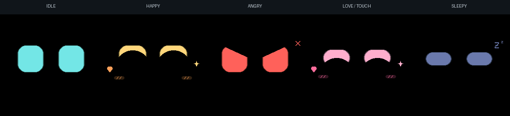
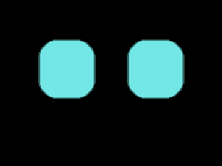
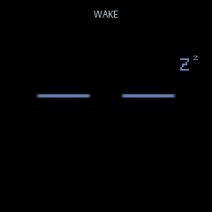

# Desk Companion Bot

หุ่นเพื่อนบนโต๊ะสำหรับ ESP32 / Arduino / PlatformIO สเปกอ้างอิงใช้ **Waveshare 2inch LCD Module รุ่น 17344 / ST7789 240×320 (แนวนอน 320×240) ผ่าน hardware SPI**, TowerPro SG90 Digital, เซ็นเซอร์ระยะ **Pololu #3415 / VL53L1X ToF** และสัมผัสหัวด้วย DFRobot DFR0030 / TTP223 ใช้ดวงตาสื่ออารมณ์โดยไม่มีปาก ไม่มีเสียง และไม่มีรูม่านตาหรือจุดกลมภายในตา







ภาพและ GIF วาดจาก renderer และท่าทางที่เฟิร์มแวร์ใช้บนคอมพิวเตอร์ โดยป้อนสถานะตัวอย่าง ไม่ใช่วิดีโอจากบอร์ดหรือหลักฐาน FPS ของจอจริง

## Build และจำลอง

ติดตั้ง PlatformIO IDE และ Wokwi Simulator ใน VS Code แล้วรัน:

```sh
pio run -e esp32dev -e esp32vibecom13 -e esp32vibecom_sonar -e esp32vibecom -e esp32sim
```

| Environment | จอ | ใช้กับ |
| --- | --- | --- |
| `esp32vibecom` | Waveshare 17344 จอ IPS 2 นิ้ว แนวนอน + SG90 Digital | เครื่องจริง โมเดล v0.4 / VL53L1X |
| `esp32vibecom_sonar` | Waveshare 17344 จอ 2 นิ้ว + SG90 Digital | เครื่องจริง โมเดล v0.2–v0.3 / HC-SR04 เดิม |
| `esp32vibecom13` | Waveshare 15867 จอ 1.3 นิ้ว + SG90 Digital | เครื่องจริง โมเดล v0.1 เดิม |
| `esp32dev` | ST7789 240×240 แบบ 7 ขา + เซอร์โวเดิม | เครื่องจริง แบบเดิม |
| `esp32sim` | ILI9341 320×240 แนวนอน | Wokwi เท่านั้น |

โปรไฟล์เริ่มต้นของ PlatformIO คือ `esp32vibecom` สำหรับรุ่นอ้างอิง อัปโหลดด้วย `pio run -e esp32vibecom -t upload` ถ้าใช้จอ 7 ขาเดิมให้ระบุ `-e esp32dev` โดยชัดเจน เปิด Serial ที่ 115200 baud ด้วย `pio device monitor`

สำหรับ Wokwi ให้ build `pio run -e esp32sim` แล้วกด F1 → **Wokwi: Start Simulator** ไฟล์ `wokwi.toml` ชี้ไปที่ `.pio/build/esp32sim/firmware.bin` และ `firmware.elf` ต้อง build และเริ่ม Simulator ใหม่หลังแก้โค้ด

หลังเริ่มต้องเห็น `Display=READY` และค่า `FPS draw` / `TFT` ขยับจากศูนย์หลังผ่านช่วงเริ่มต้น หากเคยใช้รุ่นที่ขึ้น `RGB565 canvas allocation failed` ให้ build โปรไฟล์ `esp32sim` ใหม่ก่อนเริ่มจำลอง รุ่นนี้ใช้บัฟเฟอร์ที่จองไว้ตั้งแต่ build เพื่อแก้จอดำจากการจองหน่วยความจำก้อนใหญ่ก่อน `setup()`

Wokwi ใช้ **ILI9341 เป็นตัวแทนแสดงภาพสีด้วยไดรเวอร์ของมันเอง** ไม่ใช่โมเดล ST7789 และไม่ใช้ยืนยันการเริ่มทำงานหรือความเร็วของจอจริง ไม่ต้องซื้อ ILI9341 จอจำลองหมุนเป็นแนวนอน 320×240 ทั้งตัวจอและภาพ ใบหน้าตรรกะ 240×160 ขยายเป็น 320×214 อยู่กึ่งกลางที่ (0, 13) ส่วนจอจริง 2 นิ้ว ST7789 วางแนวนอน 320×240 และใช้ใบหน้าขยายเป็น 320×214 ที่ (0, 13); โปรไฟล์ 1.3 นิ้วเดิมยังเป็น 240×240 วางหน้าที่ (0, 40)

คลิก HC-SR04 เพื่อเปลี่ยนระยะ เริ่มที่ 100 cm เป็นแหล่งป้อนระยะสำหรับทดสอบพฤติกรรมใน `esp32sim` เท่านั้น ไม่ได้จำลอง VL53L1X, I²C หรือความผิดพลาดทางแสง สวิตช์ **TTP223 OUT (simulation)** เลื่อนขวา = แตะ HIGH เลื่อนซ้าย = ปล่อย LOW เป็นการจำลองสัญญาณ OUT ไม่ใช่ความจุไฟฟ้าของเซ็นเซอร์จริง

## โมเดล 3D และรุ่นอ้างอิง


มีไฟล์ **BLEND / GLB / STL แยก 6 ชิ้น** พร้อมภาพแยกชิ้นส่วนและสคริปต์สร้างโมเดล รุ่น v0.4 หัวมนใหญ่นั่งชิดตัวเตี้ยสีเขียวอ่อน เท้าเล็กสีชมพูอิฐ ซ่อนข้อต่อหมุนไว้ในหัว เหลือรอยต่อ 0.8 มม. เปลี่ยนกระบอกเซ็นเซอร์คู่เป็นช่อง ToF เล็ก 8 × 6 มม. ที่อก ขนาดรวมประมาณ 76 × 62 × 105 มม. อ่าน [รุ่นอุปกรณ์ วิธีเปิดไฟล์ และข้อจำกัดการประกอบ](mechanical/README.md)

แบบนี้เป็นต้นแบบตรวจขนาด ยังไม่ได้พิมพ์หรือประกอบจริง ตำแหน่งรูยึด/หัวต่อ/horn และการเดินสายต้องยืนยันกับอุปกรณ์ที่ซื้อก่อนพิมพ์ครบชุด

## ต่อจอจริง Waveshare 17344 — รุ่นอ้างอิง 2 นิ้ว 8 ขา

| ขาบนจอ | ESP32 |
| --- | --- |
| GND | GND ร่วม |
| VCC | 3V3 |
| CLK | GPIO 14 |
| DIN | GPIO 23 |
| RST | GPIO 33 |
| DC | GPIO 26 |
| CS | GPIO 27 |
| BL | 3V3 เพื่อเปิด backlight |

ใช้ `esp32vibecom` รุ่นนี้มี CS ต้องต่อ GPIO27 จอวางแนวนอน พื้นที่แสดงผล 40.8 × 30.6 มม. และ PCB 58 × 35 มม. อ้างอิง [Waveshare รุ่น 17344](https://docs.waveshare.net/2inch_LCD_Module/) สายต่อเหมือนรุ่น 15867 แต่ต้องใช้โปรไฟล์ที่ตรงกับขนาดจอ

จอ Waveshare 15867 ขนาด 1.3 นิ้วเดิมใช้ `esp32vibecom13`; จอ 7 ขาเดิมใช้ `esp32dev`: SCL/SCK →14, SDA/DIN →23, RES/RST →33, DC →26, BLK →3V3, VCC →3V3, GND →GND และไม่มี CS ไม่ต้องแก้โค้ดเพื่อย้อนใช้แบบเดิม **SDA/SCL ของจอเป็น SPI ไม่ใช่ I²C** ใช้สายสั้นและกราวด์ร่วม

หากจอดำหรือภาพผิด ตรวจสายและไฟก่อน แล้วปรับ `TFT_SPI_HZ`, `TFT_SPI_MODE`, `TFT_INVERT` ต้น `src/main.cpp` ให้ตรงโมดูล เริ่มที่ 40 MHz / SPI_MODE0 / invert=true ลดเหลือ 20 MHz หากสายมีปัญหา SPI ไม่มีการตอบรับว่าจอแสดงภาพสำเร็จ ต้องตรวจภาพจริงด้วย

## เซ็นเซอร์และเซอร์โว

| อุปกรณ์ | ขา | ESP32 |
| --- | --- | --- |
| DFR0030 / TTP223 | VCC / GND / OUT | 3V3 / GND / GPIO 4 |
| Pololu #3415 / VL53L1X (รุ่น v0.4) | VIN / GND | 3V3 / GND |
| Pololu #3415 / VL53L1X (รุ่น v0.4) | SDA / SCL | GPIO 21 / GPIO 22 |
| HC-SR04 (โปรไฟล์เดิม/จำลอง) | TRIG / ECHO | GPIO 5 / GPIO 19 |
| HC-SR04 (โปรไฟล์เดิม/จำลอง) | VCC / GND | 5V / GND |
| SG90 Digital (รุ่นอ้างอิง) / Servo เดิม | PWM | GPIO 18 |
| Servo | V+ / GND | แหล่งจ่าย 5V สำหรับมอเตอร์ / GND ร่วม |

ตั้ง TTP223 เป็น **Direct / Momentary + Active HIGH** ไม่ใช้ Toggle ตรวจจัมเปอร์ตามโมดูล และปล่อยแผ่นสัมผัสว่างอย่างน้อย 1 วินาทีตอนเปิดเครื่อง โค้ดใช้ `INPUT_PULLDOWN` และกรองสัญญาณนิ่ง 25 ms แยกแตะครั้งเดียว แตะสองครั้ง และแตะค้างได้ แต่ไม่แยกทิศทางหรือความแรงการลูบ

**รุ่นปัจจุบัน:** ใช้ carrier Pololu #3415 ที่มี regulator/level shifter ไม่ใช่ชิปเปล่า จ่าย VIN จาก **3V3** เพื่อให้ pull-up ของ SDA/SCL อยู่ที่ 3.3V ขา VDD เป็นเอาต์พุต regulator ไม่ใช่ขา VIN ขา XSHUT/GPIO1 ไม่ต้องต่อเมื่อใช้ตัวเดียว ที่อยู่ I²C เริ่มต้น `0x29`; GPIO5/19 ไม่ใช้ในโปรไฟล์ ToF [ข้อมูลและผังวงจรจาก Pololu](https://www.pololu.com/product/3415)

เริ่มทำงานต้องเห็น `Distance sensor=VL53L1X READY` โค้ดใช้ Long mode, timing budget 50 ms, วัดทุก 80 ms และตรวจ data-ready ทุก 10 ms แล้ว `read(false)` จึงไม่รอรอบวัดในลูปภาพ; I²C transaction ยังใช้เวลาจริงและตั้ง timeout 10 ms รับเฉพาะ `RangeValid` ในช่วง 40–4000 mm แล้วแปลงเป็น cm ก่อนเข้าตัวกรองเดิม ค่าผิดพลาดจะไม่กลายเป็นระยะศูนย์; เมื่อไม่มีค่าถูกต้องเกิน 400 ms จะขึ้น `Distance=unavailable` และกลับพฤติกรรมไม่มีเป้าหมาย ทัชยังใช้ได้ ถ้าเริ่มเซ็นเซอร์ไม่สำเร็จจะรายงาน ERROR ให้ตรวจสายแล้วรีสตาร์ต หลังเซ็นเซอร์รีเซ็ตหรือไฟตกขณะทำงานให้รีสตาร์ตเพื่อเริ่มเซ็นเซอร์ใหม่ ไม่ได้ทำ blocking auto-init ในลูปภาพ

ระยะ 4 เมตรเป็นค่าสูงสุดตามสภาพแสง/เป้าหมาย ไม่รับรองทุกพื้นผิว ช่องที่อกเป็นรูเปิด ไม่ปิดด้วยพลาสติกพิมพ์ทึบหรือกระจกที่ยังไม่ได้คาลิเบรต ไลบรารี [Pololu VL53L1X 1.3.1](https://github.com/pololu/vl53l1x-arduino) ที่ pin ไว้ไม่ได้จัดการ calibration สำหรับ cover glass ให้ครบ ต้องทดสอบแสง วัตถุ และช่องเปิดจริงก่อนประกอบ

**ย้อนใช้ HC-SR04:** ใช้ `pio run -e esp32vibecom_sonar -t upload` และต่อ TRIG5/ECHO19 ตามรุ่นเดิม ทั้ง ToF และ sonar จอ 2 นิ้วใช้ namespace `vibecom2` และรูปแบบค่าตั้งเดิม จึงเก็บคาลิเบรตเซอร์โว/threshold ไว้ ไม่ลบ NVS เมื่อเปลี่ยนเซ็นเซอร์ ตัวถัง HC-SR04 อยู่ใน commit `a1484a8`; ตัวถัง v0.4 ไม่มีรูรับกระบอกคู่แล้ว

HC-SR04 จริงส่ง ECHO 5V ต้องลดระดับก่อนเข้า ESP32 เช่น ECHO → R 1 kΩ → GPIO 19 และ GPIO 19 → R 2 kΩ → GND ส่วน Wokwi ต่อ ECHO ตรงตามโมเดลจำลอง

เซอร์โวใช้แหล่งจ่ายที่จ่ายกระแสพอและกราวด์ร่วม รุ่นอ้างอิง SG90 Digital เริ่ม PWM 1000–2000 µs และช่วงคำสั่งคอ 15/75/135 จำกัดไม่เกิน 150 ตามรุ่น; แบบเดิมยังใช้ 500–2500 µs และ 0/90/180 ปรับตามกลไกจริงใน `src/hardware.h` ต้องคาลิเบรตกับเซอร์โวจริง จอไม่ได้ใช้ขาทัช ไม่มีลำโพงหรือ buzzer

จอ ILI9341 ใน Wokwi ต่อ MOSI → 23, SCK → 14, D/C → 26, CS → 27, VCC → 3V3 และ GND ร่วม ไม่ต่อ MISO ส่วน RST และ backlight ไม่ได้จำลองตามเอกสาร Wokwi

## สีหน้าและพฤติกรรม

| เงื่อนไข | ภาพใบหน้า | คอ |
| --- | --- | --- |
| Idle: อยู่นอกช่วงทักทาย | ตาทึบสีฟ้ามินต์ กลอกตา หายใจและกะพริบ | ตามสายตาเล็กน้อย |
| Sleepy: ไม่มีปฏิสัมพันธ์ตามเวลาที่ตั้ง (เริ่ม 10 วินาที) | ตาปรือสีม่วงหม่น มี Zz ลอยขึ้น | กลับ `neck_center` |
| Happy: ระยะอยู่ระหว่าง `near` และ `far` | ตายิ้มกว้างสีทอง ขยับกระฉับกระเฉง แก้มอุ่น | ส่ายนุ่มนวล / ทักทายเมื่อเดินเข้ามา |
| Angry: ใกล้กว่า `near` | ตาคมสีคอรัล สั่นเบา ๆ ไม่มีตายิ้ม แก้ม หรือหัวใจจากอารมณ์ก่อนหน้า | หันหนีถึง `neck_max` ที่คาลิเบรตไว้ |
| Love: ขณะสัมผัส สำคัญสูงสุด | ตาปรือยิ้มอ่อนสีชมพู เอนหน้าและมีแก้ม ต่างจาก Happy | หันใกล้ `neck_center + 8°` ขยับช้า ๆ ±3° ภายในช่วงคอ |
| ไม่มี echo ต่อเนื่อง | คงระยะเดิมได้ไม่เกิน 400 ms ก่อนเปลี่ยนกลับ Idle ยกเว้น Love / ท่าเล่น | ตามโหมดปัจจุบัน |

ระยะใช้ค่ากลางของ 3 ตัวอย่าง (วัดทุก 80 ms) และยืนยันโซนใหม่ต่อเนื่อง 160 ms ค่าเริ่มต้นเข้า Angry เมื่อ <15 cm และออกเมื่อ ≥17 cm เข้า Happy เมื่อ ≤50 cm และออกเมื่อ >53 cm จึงไม่สลับสีหน้าไปมาที่ขอบเขต ถ้าสัญญาณหายครบ 400 ms จะทิ้งหน้าต่างเก่าและรอ 3 ตัวอย่างใหม่ การเปลี่ยนอารมณ์หลังสัญญาณหายยังผ่านช่วงยืนยัน 160 ms ด้วย

การเข้าใกล้ภายใน `far` สัมผัส หรือระยะที่กรองแล้วเปลี่ยนจากจุดอ้างอิงอย่างน้อย 4 cm ปลุกจากอาการง่วง การเอนหน้าเป็นภาพบนจอ เซอร์โวหนึ่งตัวใช้หันคอ ไม่ได้ติดตามตำแหน่งซ้าย–ขวาของคน

| การสัมผัส / เหตุการณ์ | พฤติกรรม |
| --- | --- |
| แตะสั้น <500 ms ครั้งเดียว | รอ 320 ms หลังปล่อยเพื่อแยกจากสองครั้ง แล้วเงยตาและหันคอเล็กน้อย 0.9 วินาที |
| แตะสั้นสองครั้ง เริ่มครั้งที่สองภายใน 320 ms หลังปล่อยครั้งแรก | เล่นด้วย ตาสีทองและส่ายคอ 1.8 วินาที |
| แตะค้าง ≥500 ms | Love ระหว่างแตะ และค้างต่อ 1.2 วินาทีหลังปล่อยก่อนค่อย ๆ คลายท่า |
| เดินเข้าช่วง Happy จาก Idle | เหลือบมองแล้วส่ายคอทักทาย 1.6 วินาที เว้นอย่างน้อย 8 วินาทีก่อนทักครั้งใหม่ |
| ปลุกจากหลับ | ค่อย ๆ ลืมตา 1.1 วินาที |

ขณะแตะทุกแบบจะเป็น Love ทันทีหลัง debounce การแตะสั้นไม่ค้าง Love 1.2 วินาทีหลังปล่อย ท่าเล่น/ทักทาย/สนใจถูกยกเลิกเมื่อเข้า Angry และการสัมผัสครั้งใหม่ขัดจังหวะท่าเดิมได้

## ตั้งค่าผ่าน Serial และจำค่าหลังรีสตาร์ต

เปิด Serial Monitor ที่ 115200 baud ส่งคำสั่ง ASCII ทีละบรรทัดด้วย Enter (`LF` หรือ `CRLF`) ไม่เกิน 95 ตัวอักษร:

```text
help
show
profile affectionate
set sleep 15
set near 12
set far 60
set neck_min 30
set neck_max 135
set neck_center 75
save
```

| คำสั่ง | ความหมาย |
| --- | --- |
| `profile normal` | ระยะ 15/50 cm หลับหลัง 10 วินาที |
| `profile affectionate` | ขี้อ้อน ระยะ 12/65 cm หลับหลัง 10 วินาที |
| `profile sleepy` | ขี้เซา หลับหลัง 6 วินาที และส่ายคอ Happy เบาลง ระยะ 15/50 cm |
| `profile grumpy` | ขี้หงุดหงิด ระยะ 22/45 cm หลับหลัง 10 วินาที |
| `set sleep N` | เวลาหลับ 3–600 วินาที |
| `set near N`, `set far N` | `near` 5–80 cm, `far` ไม่เกิน 200 cm และต้องห่าง `near` อย่างน้อย 5 cm |
| `set neck_min N`, `set neck_center N`, `set neck_max N` | ค่าจำนวนเต็ม 0–150 สำหรับรุ่นอ้างอิง / 0–180 แบบเดิม ต้องเรียง `min < center < max` |
| `show` / `help` | แสดงค่าปัจจุบัน / คำสั่ง |
| `save` | บันทึกค่าปัจจุบันใน NVS ด้วย Preferences |
| `reset` | คืนค่าเริ่มต้นใน RAM; ส่ง `save` อีกครั้งหากต้องการบันทึกค่าเริ่มต้น |

ค่าที่แก้มีผลทันที แต่เขียน flash เฉพาะเมื่อส่ง `save` เท่านั้น รุ่น 2 นิ้วใช้ namespace `vibecom2`, รุ่น 1.3 นิ้วใช้ `vibecomref`, แบบ 7 ขาใช้ `deskbot` เพื่อเก็บคาลิเบรตแต่ละรุ่นแยกกัน `profile` เปลี่ยนระยะและเวลาหลับ แต่เก็บมุมคอที่คาลิเบรตไว้ คำสั่งผิด/ค่าผิดช่วงถูกปฏิเสธทั้งคำสั่ง บัฟเฟอร์เต็มจะทิ้งทั้งบรรทัด ข้อมูลที่บันทึกใช้รูปแบบมีเวอร์ชันใน key เดียวและตรวจความถูกต้องเมื่อโหลด หากไม่มีข้อมูลหรืออ่านไม่ได้จะใช้ค่าเริ่มต้น

ทุกท่าถูกจำกัดให้อยู่ในช่วงคอที่ตั้งไว้ รวมมุมเริ่มต้นตอนเปิดเครื่อง ปรับช่วงนี้ให้เหมาะกับกลไกก่อนใช้งานจริง การส่งคำสั่งหรือ `save` อาจหยุดภาพชั่วครู่ จึงประมวลผลเฉพาะช่วงที่ไม่ได้จับ ECHO

ทุกโหมดไม่มีปากเสี้ยววงกลม ใช้ทรงตา สี และการขยับสื่ออารมณ์แทน สถานะ Angry คุมตาทันที ไม่รอ `angryBlend` เกิน 0.5 และระงับตายิ้ม หัวใจ แก้มจากค่า Happy/Love ที่กำลังจางออก

## ความลื่นและหน่วยความจำ

วาดด้วย Adafruit GFX ลง indexed canvas สองชุด ชุดละ 240×160 = 38,400 bytes รวม **76,800 bytes ที่จองคงที่ใน RAM ตั้งแต่ build** ไม่ใช้ `malloc()` จองบัฟเฟอร์ก้อนใหญ่ใน global constructor จึงไม่มีเงื่อนไขจอถูกปิดจากการจองก้อนนั้นล้มเหลวแบบรุ่นก่อน ตัวเลข RAM ตอน build รวมบัฟเฟอร์ทั้งสองแล้ว

แต่ละเฟรมมี palette 5 สี เก็บเป็น RGB565 เต็มความแม่นยำ รวม 20 bytes สำหรับสองเฟรม ก่อนส่งจอแปลงดัชนีสีครั้งละ 8 แถวตรรกะ รุ่น 2 นิ้วขยาย 4:3 เป็นแถบ 320×10/11 pixel ใช้บัฟเฟอร์ RGB565 สูงสุด 7,040 bytes รวมพื้นที่ pixel / palette / ส่งภาพ **83,860 bytes** บวก metadata เล็กน้อย; รุ่นจอเดิมใช้บัฟเฟอร์ 3,840 bytes รวม 80,660 bytes ความละเอียด สี และเอฟเฟกต์เดิมคงอยู่ ไม่ได้ลดเป็นสี RGB332

พื้นที่ตรรกะใบหน้า 240×160 ขยายเป็น 320×214 กลางจอ 320×240 สำหรับจอ 2 นิ้ว; รุ่น 1.3 นิ้วยังเป็น 240×160 กลางจอ 240×240 พื้นที่ดำรอบหน้าล้างครั้งเดียว ภาพที่กำลังส่งไม่ถูกแก้ ขณะอีกบัฟเฟอร์วาดเฟรมใหม่ จึงไม่เกิดเฟรมดำจากการ clear จอแล้ววาดทีละชิ้น

เปรียบเทียบทั้งดัชนีและ palette กับภาพที่ส่งครบแล้วก่อนนำบัฟเฟอร์เก่ากลับมาวาด จึงยังส่งสีใหม่แม้ทรงตาไม่เปลี่ยน ส่งเฉพาะแถบที่เปลี่ยนผ่าน hardware SPI รุ่น 2 นิ้วครั้งละ 10/11 แถว = 6,400/7,040 bytes เวลาบิตบนสายประมาณ **1.28–1.41 ms ที่ 40 MHz** ต่อช่วง กรณีเปลี่ยนทั้งพื้นที่หน้าคือประมาณ **27.39 ms**; รุ่นจอเดิม 0.77 ms ต่อแถบ และ 15.36 ms ทั้งหน้า ยังไม่รวมเวลาวาด แปลงสี เรียกไลบรารี และบริการอินพุต HC-SR04 จับ ECHO ด้วย interrupt เริ่มวัดทุก 80 ms และไม่แทรก SPI/Serial ระหว่าง TRIG 10 µs

เป้าหมายสร้างภาพตรรกะ 60 Hz แต่ **ไม่รับรองจอจริง 60 FPS** จอ 2 นิ้วที่เปลี่ยนภาพเต็มพื้นที่ถูกจำกัดด้วยเวลาสาย SPI ประมาณ 36 ภาพ/วินาที ก่อนรวม overhead ต้องวัดกับโมดูลและสายจริง การส่งแถบไม่ได้ซิงก์ TE ของจอ จึงอาจมีรอยฉีกขณะเคลื่อนไหว Simulator ไม่ใช้วัดความเร็วฮาร์ดแวร์

Serial แสดง `FPS draw` (สร้างภาพ), `TFT` (ภาพเป้าหมายที่แสดงครบ รวมภาพที่เหมือนเดิมจนไม่ต้องส่งซ้ำ), `skipped` (เฟรมใหม่แทนเฟรมที่ยังไม่เริ่มส่ง) และ `SPI max` (เวลาส่งช่วงที่นานที่สุดตั้งแต่เปิดเครื่อง) ค่า TFT เป็นอัตราภาพเป้าหมายที่สำเร็จ ไม่ใช่อัตรา refresh ภายในแผง LCD

## ตรวจสอบ

```sh
pio run -e esp32dev -e esp32vibecom13 -e esp32vibecom_sonar -e esp32vibecom -e esp32sim
python tests/run_render_checks.py
```

Host test ใช้ **behavior, ท่าทาง, renderer และ Adafruit GFX ตัวเดียวกับเฟิร์มแวร์** ตรวจการกรองระยะ/ค่าหลุด/ขอบเขตอารมณ์, ช่วงทักทายซ้ำ, แตะหนึ่งครั้ง/สองครั้ง/ค้าง/สัญญาณเด้ง, หลับ/ปลุก, ตัวจับเวลาวนกลับ, คำสั่งผิดและขอบเขตค่าตั้ง, การ encode/decode ค่าที่บันทึก และการจำกัดมุมคอ

ส่วนภาพตรวจ 605 เฟรม Angry ระหว่างเปลี่ยนอารมณ์/กะพริบ และ 976 เฟรมของท่าทางร่วมกับอารมณ์ ตรวจตายังมองเห็น ไม่มีรอยยิ้มจากอารมณ์เก่าแทรก และ Happy/Love ต่างกันทั้งรูปทรง เพิ่มการตรวจ pixel ทุกตำแหน่งหลังขยาย 4:3 ความต่อเนื่องของทุกแถบ และ guard ปลายบัฟเฟอร์ รวมถึงบัฟเฟอร์อยู่ภายใน object, การเปลี่ยน palette, การขยายสี RGB565, ขอบเขตแถบภาพ และไม่มีปากทุกโหมด ไม่ใช้เฟรมเวิร์กทดสอบ

GitHub Actions ใน `.github/workflows/checks.yml` build ทั้งห้าโปรไฟล์ รัน host checks ทั้ง legacy/reference/large/ToF รวมการแปลงหน่วยและการปฏิเสธ status/bus/range ที่ผิด ตลอดจน stale timeout/reacquisition และตรวจไฟล์ STL/GLB ที่ส่งออกจริง เมื่อ push / pull request หรือสั่งเอง ล็อก platform `espressif32 @ 7.1.3` ตามเวอร์ชันที่ตรวจบิลด์แล้ว ตรวจผล run ล่าสุดได้ในแท็บ Actions ของ repo; checker ไฟล์โมเดลใช้ Python มาตรฐานและไม่ต้องติดตั้ง Blender บน CI

ต้องมี g++ C++11 ขึ้นไป หรือระบุ `--compiler` สำหรับ Windows ติดตั้งได้ด้วย `pio pkg install --global --tool platformio/toolchain-gccmingw32` ไฟล์ `tests/host` แทนเฉพาะชนิดข้อมูล Arduino ที่ GFX ต้องการ ไม่ได้จำลองบัสหรือฮาร์ดแวร์

สร้างภาพ/GIF ใหม่ด้วย `python tests/run_render_checks.py --preview` ต้องมี Pillow เพิ่มเติม

ตรวจใน Wokwi / เครื่องจริงต่อ:

1. ระยะ 100 cm ไม่แตะ: Idle สีฟ้า ไม่มีรูม่านตาหรือจุดกลมในตา
2. 30 cm → 10 cm: Happy → Angry ต้องมีตาโกรธตั้งแต่เฟรมแรกที่วาดสำหรับ Angry ไม่มีปากทั้งสองโหมด
3. แตะค้างอย่างน้อย 500 ms ที่ 10 cm: Love สีชมพูชนะระยะ ตายังทรงเดิมและกะพริบได้
4. ปล่อย: Love ต่อ 1.2 วินาที แล้วกลับ Angry ไม่มีรอยยิ้ม/แก้มค้าง ทำซ้ำและดูช่วงกะพริบ
5. 100 cm คงที่ 10 วินาที: Sleepy แล้วแตะปลุก
6. ทดสอบแตะสั้นหนึ่งครั้งและสองครั้งที่ 100 cm ดู `Action=attention` / `Action=play`; เดินจาก 100 → 30 cm ดู `Action=greeting`
7. ตั้งค่า → `save` → รีสตาร์ต ตรวจ `Settings: loaded.` และ `show` ว่าค่าตรง; ตรวจมุมคอทุกท่าไม่เกินช่วงที่ตั้ง
8. ตรวจ `Display=READY` แล้วค่า FPS ขยับจากศูนย์ เครื่องจริงให้ตรวจสี การต่อขา ค่า TFT / SPI max ทุกโหมด และเซอร์โวยังตอบสนองระหว่างส่งจอ
9. เครื่องจริง ToF: ตรวจ `VL53L1X READY`, วัดวัตถุ 10/30/100 cm หลายสีและหลายสภาพแสง ตรวจสัญญาณหายว่าไม่ค้าง Happy/Angry และยังแตะหัวได้; จำลองเซ็นเซอร์ไม่พร้อมโดยปิดไฟก่อนถอดสาย แล้วเปิดเครื่องเพื่อดู ERROR ทดสอบนี้ต้องใช้บอร์ดจริง Wokwi ไม่ได้ยืนยัน I²C/optics

รุ่นก่อนการเพิ่ม gesture/settings เคยทดสอบ runtime ใน Wokwi for VS Code แล้ว: เริ่มแสดงตาได้, Idle/Sleepy, แตะเป็น Love และปล่อยมือที่ระยะ 10 cm กลับเป็น Angry โดยไม่มีปากและไม่มีรอยยิ้มค้าง เวอร์ชันปัจจุบันผ่าน build ทั้งห้าโปรไฟล์และ host checks แต่ยังต้องตรวจ runtime Wokwi ใหม่ตามรายการข้างบน รวมทั้ง VL53L1X จริง การบันทึกข้ามรีสตาร์ตบนบอร์ด การเริ่มจอ ST7789 และ FPS ของฮาร์ดแวร์

## ไฟล์และการย้อนกลับ

- `src/main.cpp`: อินพุต อารมณ์ เซอร์โว SPI และสถิติ
- `src/hardware.h`: โปรไฟล์จอ/เซอร์โว ขีดจำกัดคอและ namespace ค่าตั้ง
- `src/distance_reading.h`: ตรวจ status/บัส/ขอบเขตค่า ToF และแปลง mm เป็น cm ก่อนกรอง
- `mechanical/`: โมเดล 3D รุ่นอ้างอิง source และ checker
- `src/behavior.h`: กรองระยะ อารมณ์ gesture ท่าทาง ค่าตั้งและการตรวจข้อมูล ใช้ร่วมกับ host test
- `src/face.h`: renderer RGB565 ที่ใช้ร่วมกับ host test
- `platformio.ini`: ไลบรารีล็อกเวอร์ชันและโปรไฟล์จริง/จำลอง
- `diagram.json`, `wokwi.toml`: วงจรตัวแทนและเฟิร์มแวร์จำลอง
- `tests/run_render_checks.py`, `tests/behavior_checks.cpp`, `tests/face_render.cpp`: ตรวจพฤติกรรม/ภาพและสร้าง preview
- `.github/workflows/checks.yml`: build และ host checks อัตโนมัติ

OLED SSD1306 เดิมอยู่ใน Git commit `dff0ec6` หากย้อนกลับให้ใช้เฟิร์มแวร์ วงจร และไลบรารีรุ่นนั้นร่วมกัน ไม่เสียบ OLED กับเฟิร์มแวร์ ST7789

อ้างอิง: [ST7789 / hardware SPI](https://learn.adafruit.com/adafruit-1-3-and-1-54-240-x-240-wide-angle-tft-lcd-displays/arduino-wiring-test), [ILI9341 ใน Wokwi](https://docs.wokwi.com/parts/wokwi-ili9341), [ตั้งค่า Wokwi](https://docs.wokwi.com/vscode/project-config), [สวิตช์จำลอง](https://docs.wokwi.com/parts/wokwi-slide-switch), [HC-SR04](https://docs.wokwi.com/parts/wokwi-hc-sr04), [TTP223](https://www.tontek.com.tw/product/product2?idx=243&lang=en)

การบันทึกค่าอ้างอิง [Preferences ของ Espressif](https://docs.espressif.com/projects/arduino-esp32/en/latest/api/preferences.html); CI อ้างอิง [PlatformIO GitHub Actions](https://docs.platformio.org/en/latest/integration/ci/github-actions.html)
