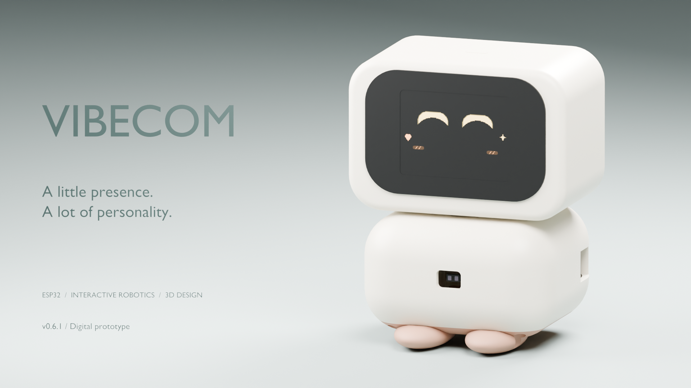
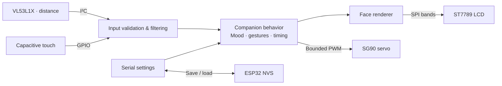

<div align="center">

# Vibecom

**A small desktop companion with an expressive face and a personality you can tune.**

[](https://github.com/syntaxguild/vibecom/actions/workflows/checks.yml)
[](https://github.com/syntaxguild/vibecom/releases/tag/v0.6.1)


[Overview](#the-project) · [Gallery](#in-motion) · [Quick start](#quick-start) · [Documentation](#documentation) · [ภาษาไทย](docs/README.th.md)

</div>



## The project

Vibecom explores how a tiny robot can feel present through **eyes, timing and movement**. An ESP32 reads distance and touch, selects an emotional state, animates an LCD face, and turns a small servo. Tap, double-tap or hold its head; approach it, give it space, or wake it from sleep.

The project brings together **embedded C++, interaction design, a custom I²C simulator and a reproducible 3D enclosure**. Its behavior runs locally through rules and state machines; it does not require an LLM or a cloud service.

| Expression | Personality | Firmware targets | Printable parts |
| :---: | :---: | :---: | :---: |
| **5** emotional states | **4** configurable profiles | **5** PlatformIO environments | **6** separate STL pieces |

**Current milestone: v0.6.1, a digitally validated prototype.** Firmware builds, shared host tests and CAD checks pass. Wokwi startup with the VL53L1X model has been confirmed by the user. Physical assembly, actual display performance and sensor behavior remain to be tested on purchased hardware.

## In motion

<table>
<tr>
<td width="50%" align="center"><br><strong>A little affection</strong><br>Touch overrides distance; release eases back into the current mood.</td>
<td width="50%" align="center"><br><strong>Small gestures, distinct reactions</strong><br>Wake, greet, tap for attention, or double-tap to play.</td>
</tr>
</table>


*These previews run the firmware's renderer on a host computer with sample inputs. They are not footage from a physical robot or a measurement of LCD frame rate.*

## Engineering highlights

- **Responsive behavior.** Touch debounce, tap/double-tap/hold recognition, filtered distance, stale-reading recovery and bounded servo movement share a testable behavior layer.
- **A small rendering footprint.** Two indexed 240 × 160 canvases, RGB565 palettes and a banded SPI transfer buffer use **83,860 bytes** for pixel/palette/transfer storage in the 2-inch profile.
- **The real driver in simulation.** A custom VL53L1X I²C chip model works with the pinned Pololu driver; a native harness checks both together with the companion's behavior.
- **Editable hardware design.** Blender source generates STL, GLB, an editable BLEND and studio renders. Artifact fingerprints connect the shipped files to their source.
- **Evidence beyond a nice render.** CAD checks cover mesh integrity, 112 envelope pairs, sampled insertion paths, head rotation and candidate enclosure screw clearance. [Read the validation scope.](docs/VALIDATION.md)

## How it works



The screen and movement react to **Idle, Happy, Angry, Love and Sleepy**. Four profiles—`normal`, `affectionate`, `sleepy`, `grumpy`—adjust temperament. Serial settings let you calibrate the servo and save preferences across restarts.

[Interaction and rendering details →](docs/FIRMWARE.md)

## The enclosure

<table>
<tr>
<td width="50%"></td>
<td width="50%"></td>
</tr>
</table>

**80 × 66 × 100.8 mm overall.** The Mochi enclosure pairs a wide cream head, a concealed rotating joint, a continuous dark face and small terracotta feet. A compact open optical aperture replaces the earlier twin ultrasonic transducers.

| Component | Reference part |
| --- | --- |
| Controller | Espressif ESP32-DevKitC V4 / ESP32-WROOM-32E |
| Display | Waveshare 17344 · 2-inch ST7789 · landscape 320 × 240 |
| Distance | Pololu #3415 · VL53L1X carrier |
| Touch | DFRobot DFR0030 capacitive touch |
| Motion | TowerPro SG90 Digital positional servo |

[Browse the 3D files](mechanical/exports/) · [Assembly & fasteners](mechanical/ASSEMBLY.md) · [CAD generation](mechanical/README.md)

The six STLs are **prototype fit-test parts**, not a production-certified kit. Confirm the purchased LCD stack, connectors, horn/spline and wiring before ordering a finished print set. [Fit report](mechanical/audit/README.md) · [Additional digital checks](mechanical/audit/ROBUSTNESS.md)

## Quick start

Install PlatformIO, then run these commands from the repository root:

```sh
git clone https://github.com/syntaxguild/vibecom.git
cd vibecom
pio run -e esp32vibecom
```

For the reference hardware, follow the [wiring guide](docs/HARDWARE.md), then:

```sh
pio run -e esp32vibecom -t upload
pio device monitor
```

For Wokwi in VS Code:

```sh
pio run -e esp32sim
```

Run **Wokwi: Start Simulator** from the command palette. If a previous diagram is cached, run **Developer: Reload Window** first. The VL53L1X custom chip is included as compiled WASM; no custom-chip compiler is needed just to run it. Wokwi access is subject to the extension's own requirements.

The simulated screen is an **ILI9341 display proxy**. It supports behavior preview, while ST7789 startup, optics, touch sensitivity and real-world performance require hardware validation.

[Full development guide →](docs/DEVELOPMENT.md) · [Custom chip implementation →](sim/README.md)

## Validation

```sh
pio run -e esp32dev -e esp32vibecom13 -e esp32vibecom_sonar -e esp32vibecom -e esp32sim
python tests/run_render_checks.py
python mechanical/check_exports.py
python scripts/check_docs.py
```

Host checks require a C++ compiler and the dependencies fetched by the firmware build. Blender is required to regenerate geometry and its audit reports; CI verifies the shipped reports and artifacts without rendering them again.

[Validation matrix and limitations](docs/VALIDATION.md) · [Architecture and design decisions](docs/ARCHITECTURE.md)

## Documentation

| I want to… | Start here |
| --- | --- |
| อ่านภาพรวมภาษาไทย | [คู่มือภาษาไทย](docs/README.th.md) |
| Connect the electronics | [Hardware & wiring](docs/HARDWARE.md) |
| Understand moods, gestures and settings | [Firmware behavior](docs/FIRMWARE.md) |
| Build, simulate or run tests | [Development](docs/DEVELOPMENT.md) |
| Understand the engineering choices | [Architecture](docs/ARCHITECTURE.md) |
| Inspect evidence and remaining risks | [Validation](docs/VALIDATION.md) |
| Print and assemble the prototype | [Mechanical guide](mechanical/README.md) · [Assembly](mechanical/ASSEMBLY.md) |
| Download a versioned snapshot | [v0.6.1 prerelease](https://github.com/syntaxguild/vibecom/releases/tag/v0.6.1) |
| Explore earlier milestones | [Changelog](CHANGELOG.md) · [Design history](docs/HISTORY.md) |

## Repository map

```text
src/          Firmware, shared behavior and face renderer
sim/          Custom VL53L1X chip source and ready-to-use WASM
tests/        Native behavior, rendering and driver integration checks
mechanical/   CAD generator, editable exports and audit evidence
docs/         Project guides, preview assets and portfolio imagery
scripts/      Documentation checks, cover rendering and release packaging
.github/      Continuous integration
```

## Credits

Developed in the [syntaxguild](https://github.com/syntaxguild) portfolio. Built with ESP32/Arduino, PlatformIO, Adafruit GFX, ESP32Servo, Pololu's VL53L1X driver, Wokwi and Blender. Hardware reference dimensions are linked in the [mechanical specification](mechanical/reference.json).

The current cover and enclosure images are rendered from the actual editable model. GIFs come from the shared firmware renderer. Earlier AI concept images are documented separately in the [design history](docs/HISTORY.md).
