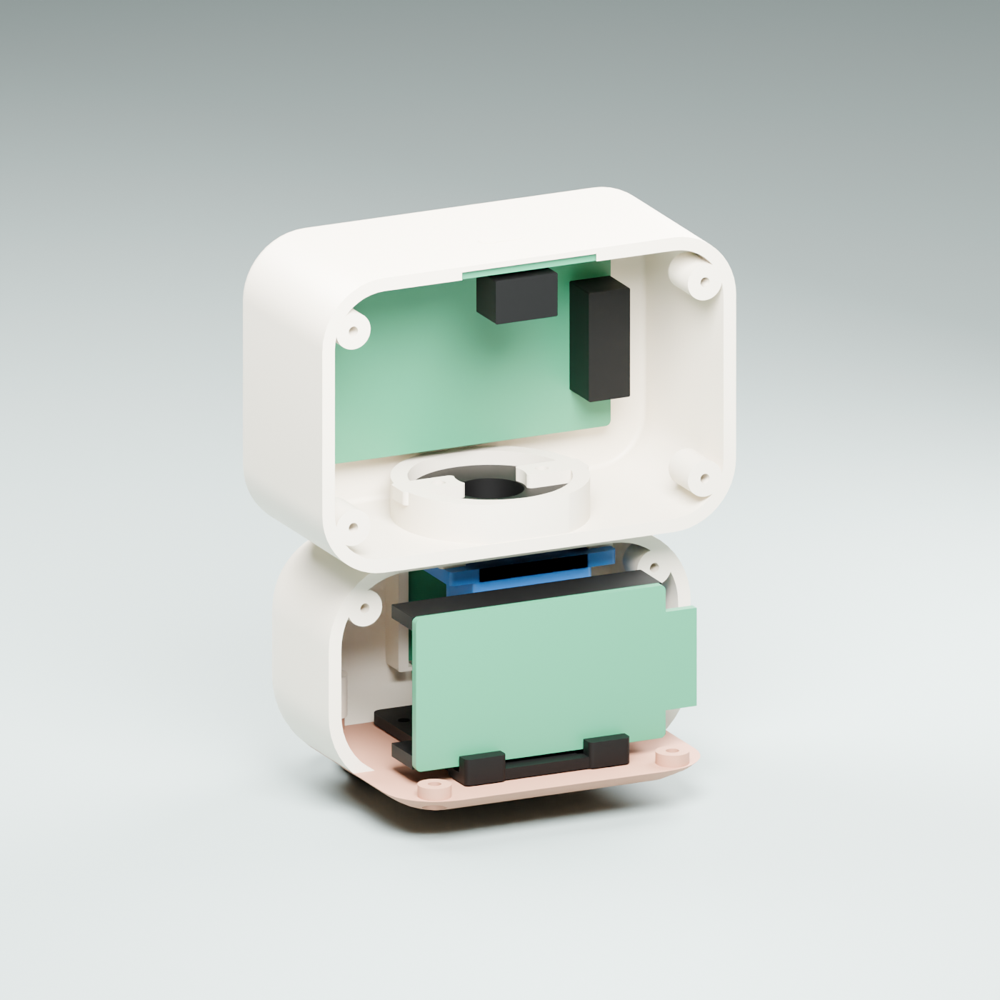

# Vibecom v0.7.0 — serviceable Mochi enclosure

[Project overview](../README.md) · [Assembly guide](ASSEMBLY.md) · [Digital evidence](audit/README.md)

ตัวถังรุ่นนี้เปิดประกอบจากด้านหลังได้ มีถาดอุปกรณ์แยกจากฐานเท้า จึงวางบอร์ดและเตรียมสายข้างนอกก่อนปิดเปลือก ไม่ต้องบิดบอร์ด ESP32 ลอดฐานหรือเอียงจอผ่านเสาสกรูแบบรุ่นก่อน

**สถานะ:** ต้นแบบตรวจ geometry ยังไม่ได้พิมพ์หรือประกอบกับอะไหล่จริง ต้องวัด LCD stack, horn/spline, หัวเสียบและสกรูที่ซื้อก่อนสั่งงานชุดสำเร็จ




## ขนาดและชิ้นส่วน

ขนาดรวม **80 × 66 × 100.8 มม.** หัว 80 × 46 × 54 มม. ตัวถังรวมฝาหลัง 70 × 62 × 42 มม. ผนังหลัก 2.4 มม. รอยต่อหัว/ตัว 0.8 มม. ฝาหลังตัวถังเว้นรอยต่อ 0.35 มม. ช่องแสง ToF เปิด 9 × 6.5 มม.

| STL — พิมพ์อย่างละ 1 | หน้าที่ |
| --- | --- |
| `01_head_rear.stl` | ฝาหลังหัว ถอดเข้าถึงจอและทัช |
| `02_head_front.stl` | เปลือกหัวหน้า เสาจอและฐานข้อต่อ; ย้ายเสาปิดฝาไปด้านข้างเพื่อเปิดทางใส่จอตรง ๆ |
| `03_face_insert.stl` | กรอบหน้าดำ ติดหลังลอง LCD stack แล้ว |
| `04_body_shell.stl` | เปลือกตัวด้านหน้า พร้อมที่ยึดเซอร์โว ช่องสาย และราง ToF |
| `05_base_cover.stl` | ฐานเท้าและจุดยึดถาด ไม่มีขารองบอร์ดติดตายบนฐานแล้ว |
| `06_neck_horn_adapter.stl` | แป้นยึด horn ที่ซ่อนในหัว ใช้ horn/spline ของเซอร์โวจริง |
| `07_body_rear.stl` | ฝาหลังตัวถัง ถอดเปิดบอร์ด/สาย มีสกรูบริการด้านหลัง 2 จุด |
| `08_electronics_tray.stl` | ถาดแยกชิ้น มีขารอง ESP32 แป้น ToF ช่องกลางสำหรับสาย และรูรัดสาย 4 ช่อง |

รายการไฟล์อ้างอิงอยู่ใน `reference.json` และใช้ตรวจทั้ง export กับ release package ห้ามผสมชิ้นส่วนรุ่นก่อนกับ v0.7.0 ตำแหน่งสกรูหัวและรูปแบบฐานเปลี่ยนแล้ว

## เปิดและส่งพิมพ์

- [STL แยกชิ้น](exports/): หน่วยมิลลิเมตร ใช้ scale 100% ให้ร้านจัดทิศและ support ใน slicer
- [Editable BLEND](exports/vibecom.blend): Blender 5.2 พร้อมชิ้นส่วนแยก วัสดุและ reference อุปกรณ์
- [GLB](exports/vibecom.glb): assembly สำหรับดูโมเดล หน่วยเมตร
- [Assembly](ASSEMBLY.md): วิธีใส่บอร์ด ลำดับปิดฝา และจุดยึด
- [Reference specification](reference.json): มิติ รุ่นอุปกรณ์ และแหล่งข้อมูล

## อุปกรณ์เป้าหมาย

| อุปกรณ์ | รุ่น / ขนาดที่ใช้ |
| --- | --- |
| จอ | Waveshare 17344, ST7789 2 นิ้ว; PCB 58 × 35, active area 40.8 × 30.6 มม.; รู 53 × 30 มม. |
| Controller | Espressif ESP32-DevKitC V4; main PCB 48.26 × 27.94 พร้อมส่วนเสาอากาศยื่น 6.04 × 18 มม. |
| Servo | TowerPro SG90 Digital positional; case 23 × 12.2 × 29 มม.; tab span อ้างอิง 32.3 มม. |
| Touch | DFRobot DFR0030; PCB 22 × 30 มม. |
| ระยะ | Pololu #3415 VL53L1X; PCB 12.7 × 17.8 × 1.02 มม.; sensor offset +0.55 มม. |

แหล่งข้อมูล: [Waveshare drawing](https://files.waveshare.com/upload/6/6d/2inch_LCD_Module_2D_Drawing.pdf), [Espressif drawing](https://dl.espressif.com/dl/schematics/esp32_devkitc_v4_dimensions.pdf), [TowerPro](https://towerpro.com.tw/product/sg90-7/), [DFRobot](https://wiki.dfrobot.com/dfr0030/), [Pololu drawing](https://www.pololu.com/file/0J1194/vl53l0x-vl53l1x-vl53l3cx-vl53l4cd-carrier-dimension-diagram.pdf)

โมเดลอุปกรณ์เป็น envelope และพื้นที่สำรองหัวเสียบ ไม่ใช่ CAD ครบรายละเอียดจากผู้ผลิตทุกราย ไม่ครอบคลุมบอร์ด clone, หัวปลั๊กทุกแบบ, horn/นัตจริง, รัศมีงอสาย หรือภาระเซอร์โว จุดทัชมีหลังคาบาง 1 มม. ซึ่งยังต้องทดสอบกับวัสดุจริง ช่อง ToF เป็นรูเปิด ไม่ใช้พลาสติกทึบหรือกระจกที่ยังไม่ได้คาลิเบรตปิดเลนส์

## สร้างและตรวจใหม่

รันจากราก repository:

```sh
blender --background --factory-startup --python-exit-code 1 --python mechanical/build_model.py
blender --background --python-exit-code 1 --python mechanical/audit_assembly.py -- --strict
blender --background --python-exit-code 1 --python mechanical/check_robustness.py -- --strict
python mechanical/check_exports.py
```

ใช้ `-- --check-only` กับ builder เมื่อต้องการตรวจ geometry โดยไม่เขียน exports ใหม่ CI ตรวจไฟล์ที่ส่งออกกับ fingerprint ของ source และรายงาน ไม่ได้เปิด Blender บน CI ผลตรวจในคอมไม่ใช่การรับรองการผลิตจริง
