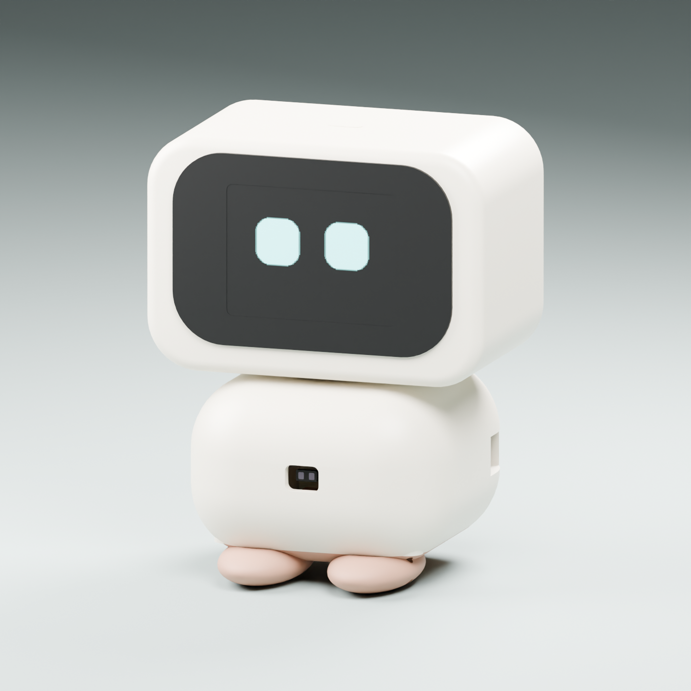
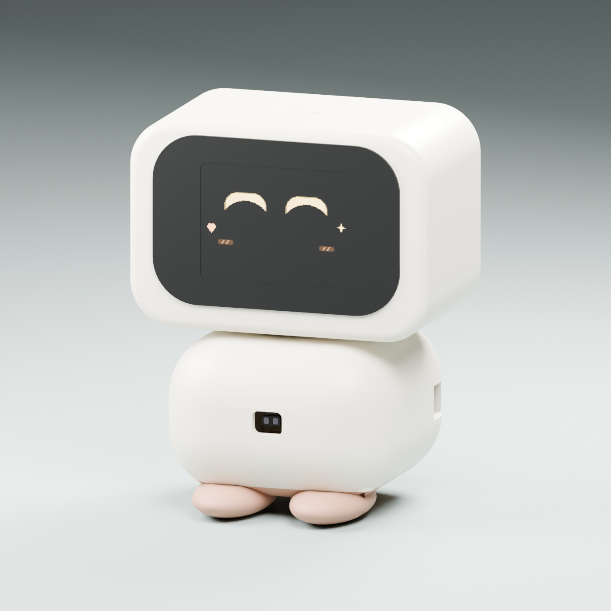
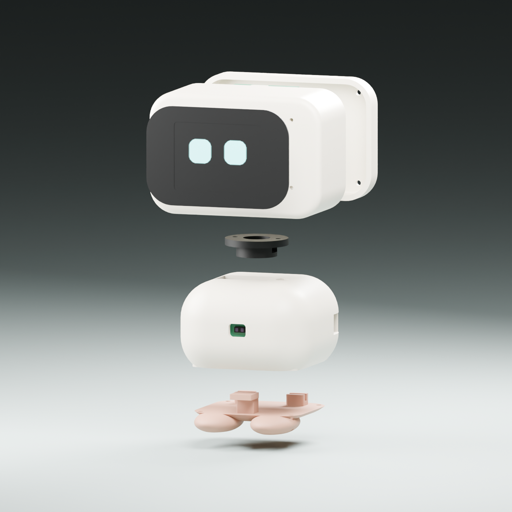

# Vibecom — Mochi companion prototype v0.5

ดีไซน์ **Mochi v0.5**: หัวทรงสี่เหลี่ยมมนหน้ากว้าง สีครีมต่อเนื่องกับตัว หน้ากากดำกว้างขึ้นและบางลง เท้าสีดินเผายื่นด้านหน้าเล็กน้อย ขอบหัวม้วนเพียง 3 มม. ทำให้คางลงมาปิดข้อต่อจากด้านหน้า โดยยังเหลือรอยต่อหมุน 0.8 มม. ช่อง ToF เปิด 8 × 6 มม. ขนาดรวมประมาณ **80 × 66 × 101 มม.** (กว้าง × ลึก × สูง รวมเท้า) จอเดิม IPS 2 นิ้วมีพื้นที่แสดงผลจริง 40.8 × 30.6 มม.; สีหน้าเรนเดอร์จากเฟิร์มแวร์

หัวเปลี่ยนจาก 76 × 46 × 58 เป็น 80 × 46 × 54 มม. จุดยึดจออยู่สูงกว่าศูนย์หัว 2 มม. เพื่อรักษาระยะเหนือสะพานยึดเซอร์โว หน้ากาก 66 × 44 มม. หนา 0.8 มม. ตำแหน่งผิวจอในภาพเป็น stack อ้างอิงสำหรับลองประกอบ ต้องวัดความหนาโมดูลจริงก่อนสรุปความเสมอกันของผิว ตัวถังคงความโค้งที่เว้นพื้นที่ให้บอร์ด แต่ลดความยาวช่องราง ToF ด้านล่างเพื่อไม่ให้ทะลุเป็นรอยเว้าบนผิวภายนอก จุดทัชในภาพเป็นเครื่องหมายสีเดียวกับเปลือก ใช้สติกเกอร์หรือทำเครื่องหมายภายหลังได้ ไม่ใช่ชิ้น STL เพิ่มเติม

**สถานะ: แบบต้นแบบสำหรับตรวจขนาดและทดลองประกอบ ยังไม่ได้พิมพ์หรือประกอบกับชิ้นส่วนจริง** การตรวจผิวปิดของ STL ไม่ได้ยืนยัน fit, ความแข็งแรง, การชนขณะหมุน หรือการทำงานของทัชผ่านพลาสติก







## รุ่นอุปกรณ์ที่เลือก

| อุปกรณ์ | รุ่นอ้างอิง | ขนาดที่นำมาใช้ |
| --- | --- | --- |
| จอ | Waveshare **2inch LCD Module, SKU 17344** / ST7789, 8 ขา | PCB 58 × 35 มม.; active area แนวนอน 40.8 × 30.6 มม. |
| เซอร์โว | TowerPro **SG90 Digital positional** | เคส 23 × 12.2 × 29 มม.; ใช้ horn เดิมที่มากับเซอร์โว |
| บอร์ด | Espressif **ESP32-DevKitC V4 / ESP32-WROOM-32E** | PCB 27.94 × 48.26 มม. |
| สัมผัสหัว | DFRobot **Gravity DFR0030** / TTP223-BA6 | PCB 22 × 30 มม. |
| ระยะ | **Pololu #3415 / VL53L1X carrier (irs11a)** | PCB 12.7 × 17.8 × 1.02 มม.; stack ประมาณ 2.3 มม. ไม่รวมสาย/ขาเสียบ |

แหล่งขนาด/สเปก: [Waveshare](https://docs.waveshare.net/2inch_LCD_Module/), [TowerPro](https://towerpro.com.tw/product/sg90-7/), [มิติ DevKitC V4](https://dl.espressif.com/dl/schematics/esp32_devkitc_v4_dimensions.pdf), [DFRobot](https://wiki.dfrobot.com/dfr0030/), [Pololu #3415](https://www.pololu.com/product/3415), [drawing ของ PCB irs11a](https://www.pololu.com/file/0J1194/vl53l0x-vl53l1x-vl53l3cx-vl53l4cd-carrier-dimension-diagram.pdf)

รุ่นเหล่านี้เป็น **สเปกเป้าหมายที่เลือกสำหรับงานนี้** ไม่ใช่การยืนยันว่าอุปกรณ์ที่ผู้ใช้มีอยู่เป็นรุ่นเดียวกัน บอร์ด clone แม้ชื่อคล้ายกันอาจมีขนาดและระยะรูต่างกัน

## ไฟล์ที่เปิดใช้ได้

- [vibecom.blend](exports/vibecom.blend): เปิดแก้ใน Blender 5.2 มีชิ้นส่วนแยกชื่อ วัสดุ กล้อง และ reference ของอุปกรณ์ซ่อนตอน render
- [vibecom.glb](exports/vibecom.glb): โมเดลประกอบพร้อมสี/ภาพตา ใช้ดูในโปรแกรมรองรับ glTF; หน่วยเมตร สูงประมาณ 0.105 ม.
- `exports/*.stl`: ชิ้นส่วนตัวถังทั้ง 6 ชิ้น หน่วยมิลลิเมตร ตำแหน่งอ้างอิงตอนประกอบ ต้องจัด orientation และวางลงฐานใน slicer ก่อนพิมพ์
- [reference.json](reference.json): ขนาดหลัก รุ่นอุปกรณ์ และลิงก์แหล่งข้อมูล
- [build_model.py](build_model.py): สร้าง geometry, STL, BLEND, GLB และภาพใหม่
- [validation.json](exports/validation.json): รายงานตรวจ mesh และ fingerprint ของ source

| STL | ชิ้นส่วน | จุดประกอบ |
| --- | --- | --- |
| `01_head_rear.stl` | ฝาบริการหัวด้านหลัง | เปิดเข้าถึงจอและทัช สกรูซ่อนด้านหลัง |
| `02_head_front.stl` | เปลือกหัวด้านหน้า | หน้าต่าง 42 × 33 มม., เสารองจอ, ฐานยึดแป้นหมุนภายใน และหลังคาบางสำหรับทัช |
| `03_face_insert.stl` | แผ่นหน้าสีดำ | ใช้เทปกาวบางหรือกาวที่เหมาะกับวัสดุหลังตรวจ fit |
| `04_body_shell.stl` | ตัวถังทรงมน | ช่อง ToF 8 × 6 มม., ที่นั่ง PCB เปิดเข้าด้านใน, ช่อง USB และร่องยึดเซอร์โว |
| `05_base_cover.stl` | ฐานและเท้าเล็ก | แป้นรอง ToF ด้านหน้าและขารอง DevKitC ด้านหลังที่หลบเสาสกรู ไม่สมมติรู PCB |
| `06_neck_horn_adapter.stl` | แป้น horn ซ่อนในหัว | คงชื่อไฟล์เดิม ใช้ horn และสกรู spline เดิม มีร่องปรับตำแหน่งสกรู และช่องสายเข้าด้านข้าง |

ผนังหลัก 2.4 มม.; จุดสัมผัสหัวเหลือหลังคา 1 มม. สกรูปิดฝามี clearance 2.4 มม. และ pilot 1.8 มม. เป็นจุดเริ่มต้นสำหรับทดลอง M2 แบบยึดพลาสติก ความยาวสกรูและขนาด pilot ต้องเลือกจากชิ้นทดสอบ วัสดุ และสกรูจริง

DFR0030 วางขวางหัว (ด้าน 30 มม. ตามแกนซ้าย–ขวา) เพื่อให้ PCB อยู่ใต้ช่วงหลังคาที่ค่อนข้างราบ แทนการดันปลายบอร์ดเข้ามุมโค้งด้านหลัง

ToF ใช้ที่นั่ง PCB ที่เปิดเข้าด้านใน ยกบอร์ดเข้าจากช่องฐานขณะถอดฐาน แล้วเลื่อนเข้าหาช่องอกจนวางบนแนวหยุดด้านหน้า ยึดด้านหลังด้วยเทป/กาวที่เหมาะกับ PCB หลังตรวจ fit โดยไม่ปิดหน้าเลนส์ แล้วประกบฐานให้แป้นรูป L รองใต้บอร์ด ที่นั่งมีระยะข้างประมาณ 0.4 มม. และเผื่อด้านหน้า PCB ประมาณ 0.24 มม. เป็นค่าทดลอง ไม่มีตัวล็อก snap ที่รับรองแล้ว ต้องยืนยันความแน่น เส้นทางใส่จริงและตำแหน่งอุปกรณ์บน PCB ก่อนพิมพ์ทั้งตัว แป้นยื่นอาจต้องมี support ตามแนวพิมพ์ เลือกบัดกรีสายหรือขาที่หันเข้าตัวถังและไม่ชนที่นั่ง แทนการสมมติว่า header ทุกแบบจะใส่ได้

ช่องแสงเป็น **รูเปิด** ไม่มีแผ่นดำทึบหรือ cover glass ในทางแสง ชิ้นเซ็นเซอร์ในภาพเป็น reference envelope ไม่ใช่แบบเลนส์จากผู้ผลิต ตำแหน่งศูนย์เลนส์บน PCB ยังต้องเทียบอะไหล่จริง ถ้าต้องการหน้าต่างดำปิดเรียบ ต้องเลือกวัสดุส่งผ่าน 940 nm, ออกแบบแยกทางแสงส่ง/รับ และคาลิเบรต crosstalk ตาม [แนวทาง ST](https://www.st.com/resource/en/application_note/dm00542648-cover-window-guidelines-for-the-vl53l1x-long-distance-ranging-time-of-flight-sensor-stmicroelectronics.pdf) ก่อนเปลี่ยนแบบ

ใต้หัวรุ่นนี้อยู่ที่ Z=46.8 มม. แป้นหมุนเดิมอยู่ในโพรงใต้หัวและยึดกับสะพานภายในเหนือหน้าแปลนที่ Z=54 มม. เลือกพิมพ์แป้นสีดำตามโมเดลเพื่อลดการเห็นข้อต่อในเงาใต้หัว สะพานหนา 2.4 มม. อยู่ต่ำกว่าขอบ PCB จอประมาณ 1.9 มม. ผิวใต้หัวต่ำสุดอยู่เหนือไหล่ 0.8 มม. จึงมีช่องสำหรับหมุนใน geometry เปล่า ต้องตรวจหัวสกรู สาย และ tolerance จริงเพิ่ม สะพานยึดอาจต้องมี support ตามแนวพิมพ์ที่เลือก

## สิ่งที่ต้องยืนยันก่อนพิมพ์ทั้งตัว

1. **จอ:** ระยะรูเริ่มต้น 53 × 30 มม., ความสูง stack ของ LCD/PCB, ตำแหน่ง active area, หัวต่อและระยะงอสายเป็นค่าจัดวางเบื้องต้น ต้องเทียบ drawing/วัดบอร์ดจริงก่อนยึดฝาหน้า
2. **เซอร์โว:** ยืนยันตำแหน่งแกน ความสูง spline ระยะรู tab และรูบน horn รุ่นที่ซื้อ ร่องบน adapter เป็นจุดเริ่มต้น ห้ามแทน horn ด้วย spline ที่พิมพ์โดยเดาแบบ
3. **เซ็นเซอร์ระยะ:** ยืนยันบอร์ด Pololu #3415, ความหนา PCB, ตำแหน่งศูนย์เลนส์จริง, ช่องรับแสงและสายต่อ รางสอดกับแป้นฐานเป็นจุดเริ่มต้น ต้องไม่กดหน้าเลนส์หรือให้ขอบช่องบัง FoV ทดสอบระยะกับแสงและวัตถุจริงโดยยังไม่ปิดหน้าต่างแก้ว
4. **สายไฟและรอยต่อ:** เดินสายจอ/ทัชผ่านข้อต่อซ่อนโดยเว้น loop ให้หันได้และไม่ขูด horn ทดสอบเต็มช่วงการหมุน ตรวจรอยต่อ 0.8 มม. หลังพิมพ์จริง และปรับ clearance ถ้าผิวเสียดสี ชิ้นส่วนนี้ยังไม่มี bearing แยกรับน้ำหนักหัว
5. **ทัช:** ทดสอบ DFR0030 ที่ 3.3V แบบ active HIGH ผ่านชิ้นทดสอบพลาสติกหนา 1 มม. ก่อนเลือกกาว/ผนังจริง เส้นสายและสภาพแวดล้อมมีผลต่อความไว
6. **การประกอบ:** ตรวจหัวสกรู ชิ้นส่วนที่ยื่นจาก PCB และการเสียบ USB จริง อย่าใช้เพียง envelope ในไฟล์เป็นหลักฐานว่าประกอบได้

โมเดลอุปกรณ์ภายในเป็น envelope อย่างง่าย ไม่ใช่ CAD จากผู้ผลิตและไม่รวมขา/header/สายทุกเส้น ควรพิมพ์ชิ้นทดสอบฝาหน้า/ข้อต่อซ่อนและวัดอะไหล่ก่อนสั่งพิมพ์ครบชุด

## เฟิร์มแวร์สำหรับรุ่นอ้างอิง

```sh
pio run -e esp32vibecom
pio run -e esp32vibecom -t upload
```

โปรไฟล์นี้ใช้ CS จอที่ GPIO27, ขาอื่นตามตารางใน README หลัก; DFR0030 OUT → GPIO4, VCC → 3V3; **VL53L1X carrier VIN → 3V3, GND → GND, SDA → GPIO21, SCL → GPIO22** ขา VDD ไม่ใช่ VIN จ่าย carrier ที่ 3.3V เพื่อให้ pull-up I²C อยู่ที่ระดับเดียวกับ ESP32 ไม่ใช้ TRIG5/ECHO19 ในรุ่นนี้

SG90 Digital ผู้ผลิตไม่ได้รับรองการหมุน 180° สำหรับรุ่นปกติ จึงตั้งช่วงคำสั่งเริ่มต้น `15 / 75 / 135`, ปฏิเสธ `neck_max >150` และเริ่ม PWM ที่ 1000–2000 µs มุมคำสั่งใน Servo API ไม่ใช่การรับรององศาที่วัดได้จริง ต้องคาลิเบรต travel และกระแสกับเซอร์โวจริงก่อนติดหัว ใช้แหล่งจ่ายมอเตอร์ที่เหมาะสมและกราวด์ร่วม

ค่าตั้งรุ่น 2 นิ้วใช้ NVS namespace `vibecom2` แยกจาก `vibecomref` ของรุ่น 1.3 นิ้วและ `deskbot` ของจอ 7 ขา จึงไม่รับช่วงคอ 180° ที่เคยบันทึกมาอัตโนมัติ หลังแฟลชให้ `show` → คาลิเบรต → `save` ถ้าจะกลับจอ Waveshare 15867 เดิม ใช้ `pio run -e esp32vibecom13 -t upload`; ถ้าจะกลับจอ 7 ขา ใช้ `pio run -e esp32dev -t upload` พร้อมการต่อแบบเดิม ค่าตั้งเดิมยังอยู่ใน namespace ของมัน

## สร้างและตรวจไฟล์ใหม่

แก้ขนาดหลักใน `reference.json` และตำแหน่งยึด/ชิ้นส่วนใน `build_model.py` แล้วรัน:

```sh
blender --background --factory-startup --python-exit-code 1 --python mechanical/build_model.py
python mechanical/check_exports.py
```

ตัวสร้างตรวจ mesh ก่อน export; checker อ่าน STL ที่ส่งออกจริงอีกครั้งเพื่อตรวจว่าทุกขอบมีสองหน้า เนื้อแต่ละชิ้นต่อกันเป็นชิ้นเดียว ปริมาตรเป็นบวก และ GLB ใช้สเกลถูกต้อง CI รัน checker ได้ด้วย Python มาตรฐาน แต่ไม่ได้ regenerate/render ด้วย Blender บน GitHub

รายงาน v0.4 เพิ่มการตรวจปริมาตรชนของตัวถัง/ฐาน, ตัวถัง/PCB ToF และฐาน/PCB ToF รวมทั้งยิงแนวแสงอ้างอิง 36 เส้นผ่านช่องอกที่ ±13.5° ทั้งสองแกน ผลนี้ตรวจเฉพาะ geometry อ้างอิงที่วางไว้ ไม่รวมสาย หัวสกรู เลนส์จริง ความคลาดเคลื่อนจากการพิมพ์ หรือการตอบสนองทางแสง

รุ่น v0.1 อยู่ใน Git commit `84d022a`; v0.2 ที่มีคอสั้นอยู่ใน `eaf60a8`; v0.3 หัวชิดตัวและ HC-SR04 อยู่ใน `a1484a8` รุ่น v0.4 (`d05f112`) เปลี่ยนเซ็นเซอร์และฐานยึด แต่เก็บจอ/เซอร์โว/รอยต่อเดิม ถ้าจะย้อน HC-SR04 ให้ใช้ตัวถังรุ่นเก่า ต่อ TRIG5/ECHO19 ตามวงจรเดิม และแฟลช `esp32vibecom_sonar` ค่าตั้งจอ 2 นิ้วใช้ namespace `vibecom2` ร่วมกันเพื่อเก็บคาลิเบรต ไม่ต้องล้าง NVS ภาพพรีเซนต์ AI ใน `output/imagegen` เป็นดีไซน์ v0.3 ที่เก็บเป็นประวัติ


v0.5 ปรับทรงหัว หน้ากาก เท้า และราง ToF; ใช้อุปกรณ์ วงจร เฟิร์มแวร์ และคาลิเบรตชุดเดิม ภาพสามภาพข้างต้นเรนเดอร์ด้วย Cycles จาก BLEND ชุดเดียวกับ STL/GLB ไม่ใช่ภาพ AI
